<div align="center">

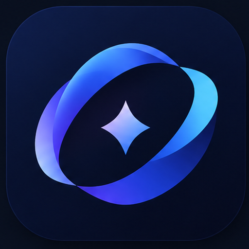

# Solance

### Um notch vivo para o Windows

Música, letras sincronizadas, Spotify, timer de foco, lembrete de água, prateleira de arquivos, tarefas e alertas do sistema — tudo num pequeno notch no topo da sua tela.<br/>
Ele fica quietinho até acontecer alguma coisa e depois sai do caminho.

[English](README.md) · **Português (Brasil)**

[**Baixar para Windows**](https://github.com/LGueddes/Solance/releases/latest) &nbsp;•&nbsp; [Guia do Spotify](docs/SPOTIFY.pt-BR.md) &nbsp;•&nbsp; [Perguntas frequentes](#perguntas-frequentes-e-solução-de-problemas)


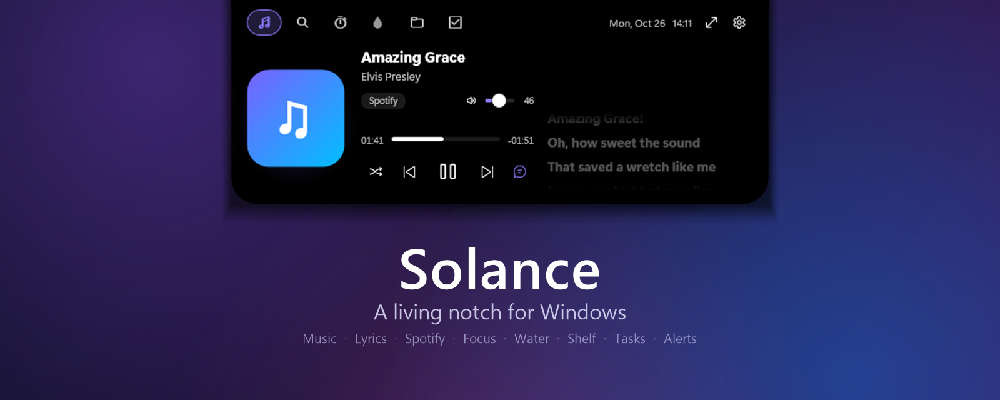

</div>

> As capturas de tela abaixo estão em inglês (o Solance muda de idioma a qualquer momento).

---

## O que é o Solance?

O Solance transforma a borda superior da sua tela em um pequeno **notch** animado. Passe o mouse e ele abre numa central de controle organizada; afaste o mouse e ele volta a ser uma pílula fina que mostra a hora, o que está tocando ou uma contagem regressiva.

Sem janela para arrumar, sem nada para fixar. Foi feito para parecer que sempre fez parte do Windows.

<div align="center">

<br/><sub>Fechado: capa, equalizador e a linha da letra que está tocando agora.</sub>
</div>

## Destaques

| | |
|---|---|
| **Música de qualquer player** | Spotify, YouTube no navegador, Apple Music, VLC… Capa, controles, barra de progresso — e a cor de destaque acompanha a capa do álbum. |
| **Letras sincronizadas** | A linha atual acende conforme é cantada. Clique numa linha para pular até ela. Também aparece embaixo do notch fechado. |
| **Aba Spotify** | Pesquise músicas, artistas, álbuns e playlists, veja *as suas* playlists e curtidas, toque, adicione à fila, use o aleatório (inclusive o inteligente) e mude o volume. |
| **Timer de foco** | Pomodoro com foco / pausa curta / pausa longa, ciclos e um aviso sonoro suave. A contagem aparece no próprio notch fechado. |
| **Lembrete de água** | Botões de copo e garrafa, meta diária e gráfico hora a hora. Lembretes gentis dentro do seu horário. |
| **Prateleira de arquivos** | Arraste arquivos para o notch para tê-los por perto. Arraste de volta para um chat, e-mail ou outra pasta. |
| **Tarefas** | Anote uma tarefa, com horário opcional (`14:30`, `9h`, `+15`, `+1h`), e o notch avisa na hora. |
| **Alertas do sistema** | Volume, brilho, Caps/Num Lock, idioma do teclado, carregador e bateria, Wi-Fi/internet, fones Bluetooth e troca de música. |
| **Um pequeno companheiro** | Com o PC parado, o relógio dá lugar a um par de olhos que piscam, seguem o cursor, cochilam e acenam quando você volta. |
| **Painel em overlay** | Um atalho (padrão `Ctrl+Alt+A`) abre todos os módulos em tela cheia, por cima de tudo. |
| **Amigo dos jogos** | Escolha se o notch aparece sobre jogos em janela sem bordas e vídeos, ou sobre tela cheia exclusiva. |
| **Do seu jeito** | 8 temas, todas as cores, fontes, tamanhos, cantos, estilo e elasticidade da animação, monitor, quais módulos e alertas você quer. |
| **English e Português** | Troque o idioma quando quiser, sem reiniciar. |

## Visita guiada

### Música e letras

<div align="center">
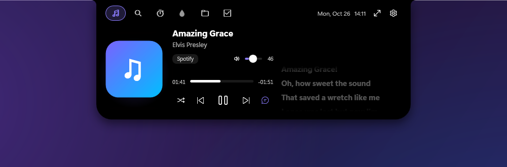
</div>

Funciona com tudo o que o Windows informa como "tocando agora". Se a música é do **Spotify** e você conectou a conta, também ganha volume e aleatório aqui mesmo — inclusive o **aleatório inteligente**.

### Spotify: pesquise e toque

<div align="center">

</div>

Pesquise, veja suas playlists e curtidas, clique para tocar e, ao passar o mouse numa música, aperte **+** para pôr na fila. Configurar leva uns dois minutos: **[guia passo a passo →](docs/SPOTIFY.pt-BR.md)**

> As capas, as playlists e o nome da conta do Spotify estão borrados de propósito nas imagens.

### Foco, água, prateleira e tarefas

<table>
<tr>
<td width="50%">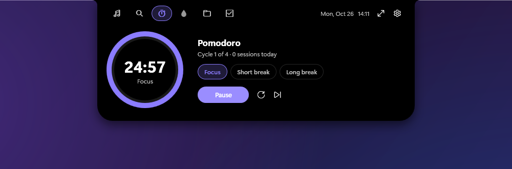</td>
<td width="50%">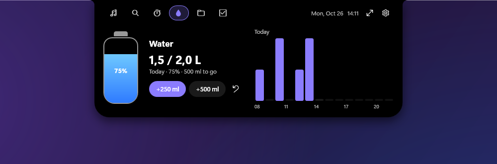</td>
</tr>
<tr>
<td align="center"><b>Foco (Pomodoro)</b></td>
<td align="center"><b>Água</b> — copo, garrafa, meta e gráfico por hora</td>
</tr>
<tr>
<td width="50%">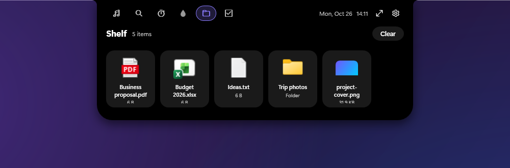</td>
<td width="50%">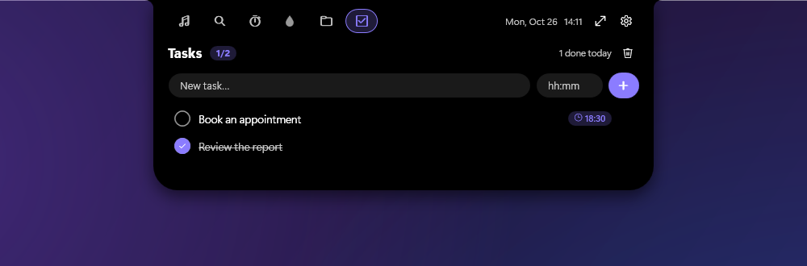</td>
</tr>
<tr>
<td align="center"><b>Prateleira</b> — arraste para dentro e para fora, clique para abrir</td>
<td align="center"><b>Tarefas</b> — com lembrete de horário opcional</td>
</tr>
</table>

### Alertas que não atrapalham

<table>
<tr>
<td width="50%"></td>
<td width="50%"></td>
</tr>
</table>

Também: brilho, idioma do teclado, carregador conectado / bateria fraca, mudanças de Wi-Fi e internet, fones Bluetooth e músicas novas. Todos os alertas podem ser desligados.

### Tudo de uma vez: o painel em overlay

<div align="center">
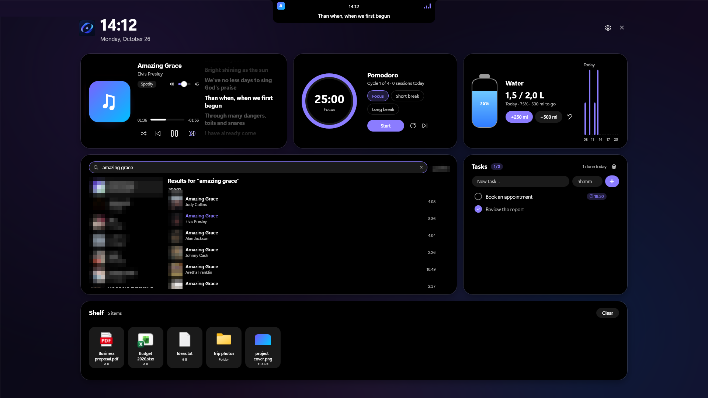
</div>

Aperte **`Ctrl+Alt+A`** (troque por qualquer combinação) para abrir todos os módulos de uma vez. Clique fora ou aperte `Esc` para fechar.

### Deixe do seu jeito

<div align="center">
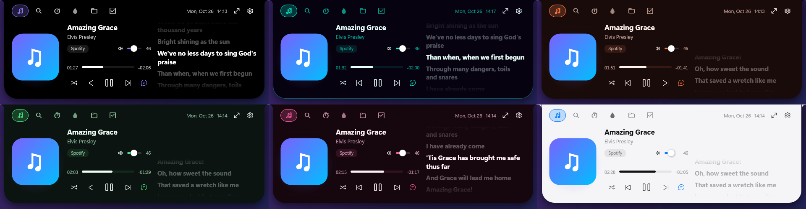
<br/><sub>Clássico, Neon, Pôr do sol, Floresta, Rosa e Claro — além de Grafite e Vidro.</sub>
</div>

<table>
<tr>
<td width="50%">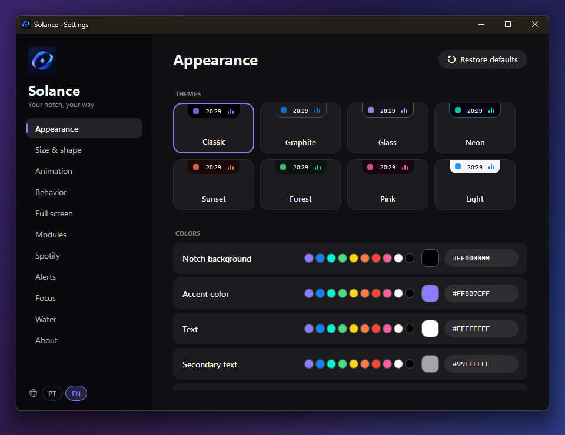</td>
<td width="50%">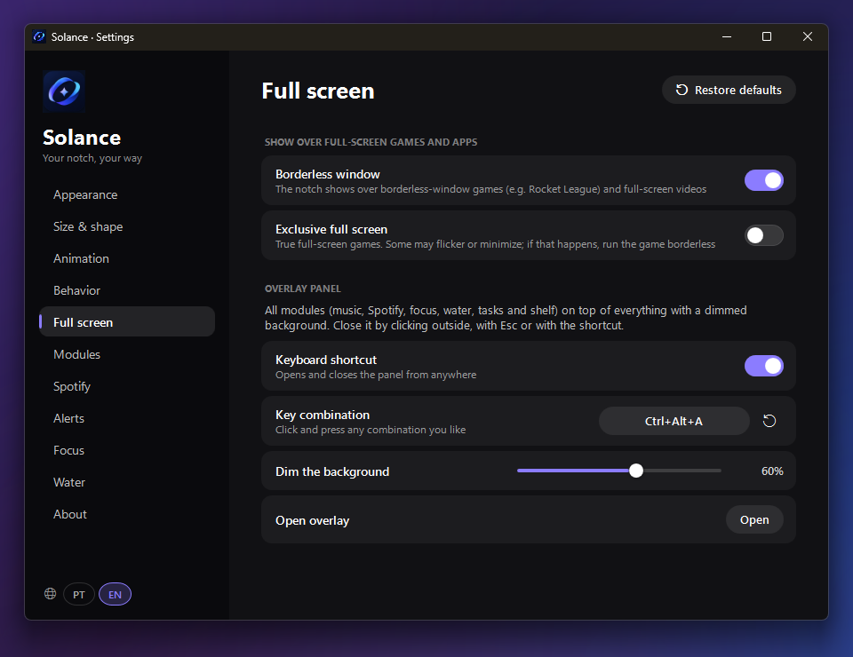</td>
</tr>
<tr>
<td align="center"><b>Aparência</b> — temas, cores, fontes</td>
<td align="center"><b>Tela cheia</b> — jogos, overlay, atalho</td>
</tr>
<tr>
<td width="50%">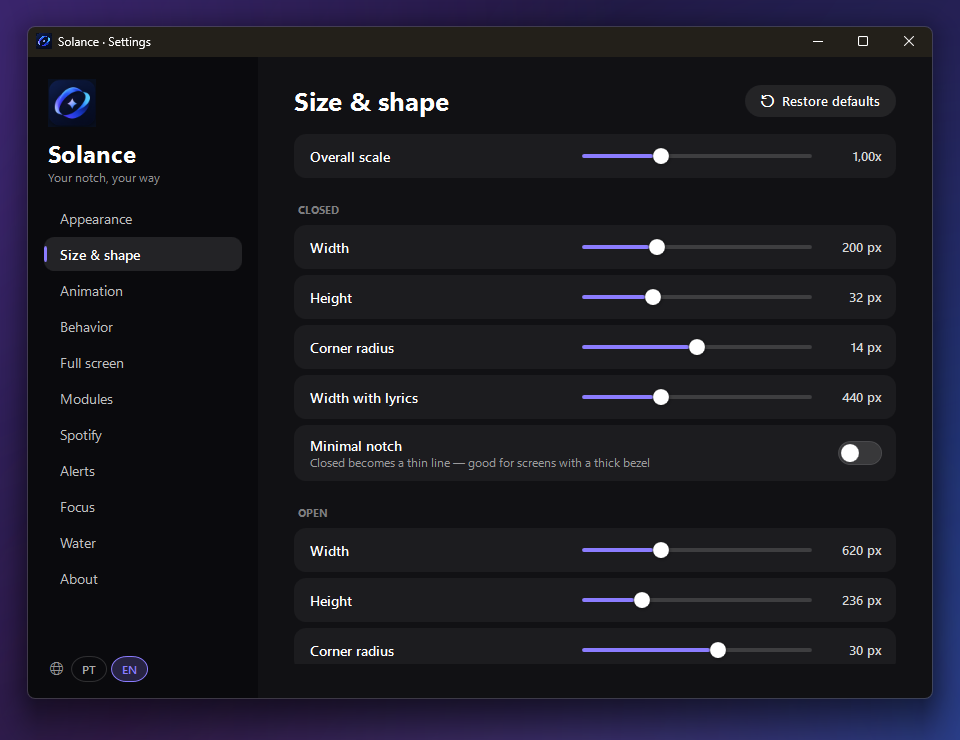</td>
<td width="50%">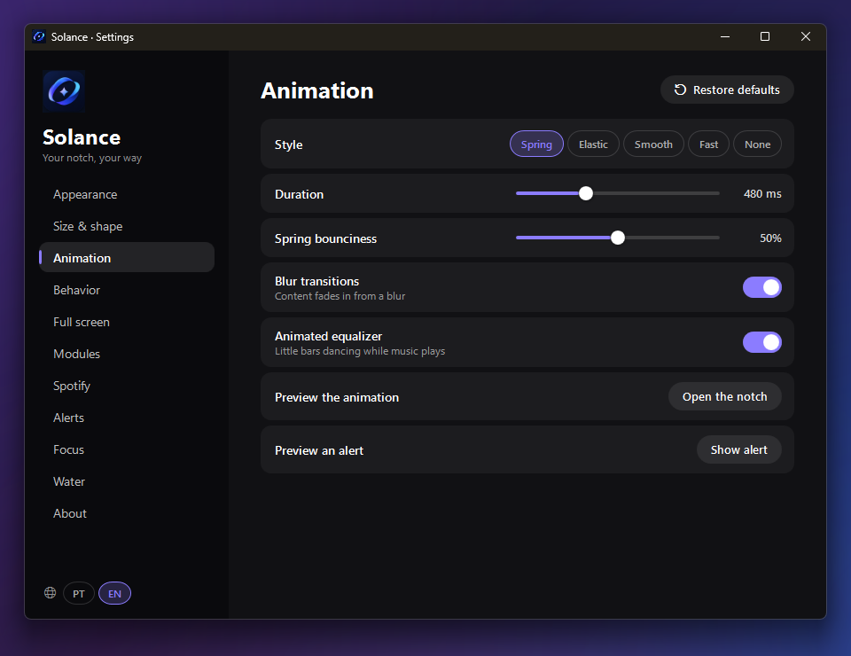</td>
</tr>
<tr>
<td align="center"><b>Tamanho e forma</b> — fechado, aberto, alertas, cantos</td>
<td align="center"><b>Animação</b> — mola, elástica, suave, nenhuma</td>
</tr>
</table>

Toda página de configurações tem um botão **Restaurar padrões**.

### Um pequeno companheiro

Deixe o PC parado um instante e o relógio dá lugar a um par de olhos que piscam e seguem o cursor, cochilam depois de um tempo e acenam quando você volta. Prefere um notch quieto? Desligue em **Configurações → Comportamento**.

---

## Instalar

1. Vá até a **[última versão (release)](https://github.com/LGueddes/Solance/releases/latest)** e baixe o **`SolanceSetup-1.0.0.exe`**.
2. Execute. **Não precisa de administrador** — ele instala só para você.
3. Se quiser, marque *Iniciar o Solance com o Windows* e *Atalho na Área de Trabalho*.
4. Conclua e olhe para o centro do topo da tela. Passe o mouse no notch para abrir.

**Requisitos:** Windows 10 (1809 ou mais novo) ou Windows 11, 64 bits. Não precisa instalar mais nada — o .NET vem junto.
Desenvolvido e testado no Windows 11.

### “O Windows protegeu o seu PC” — isso é normal?

Sim. O Solance é um app novo e independente, e ainda não tem assinatura digital de código, então o Windows SmartScreen mostra um aviso na primeira vez:

1. Clique em **Mais informações**
2. Clique em **Executar assim mesmo**

Você pode conferir se o arquivo baixado é exatamente o publicado aqui. No PowerShell:

```powershell
Get-FileHash .\SolanceSetup-1.0.0.exe -Algorithm SHA256
```

Compare o resultado com o `SHA256SUMS.txt` da página da release. Se for diferente, não execute.

### Desinstalar

*Configurações → Aplicativos → Aplicativos instalados → Solance → Desinstalar.* Ele pergunta se você também quer remover seus dados (configurações, tarefas, registro de água, prateleira, login do Spotify). A escolha é sua.

## Conectar o Spotify (opcional)

Você não precisa do Spotify para usar o Solance — a música de qualquer player funciona direto. Para **pesquisa, suas playlists, curtidas, fila e reprodução**, conecte a sua conta do Spotify.

Cada pessoa cria o próprio app gratuito de desenvolvedor no Spotify (uns dois minutos), então nada passa pela conta de outra pessoa.

**[Siga o passo a passo](docs/SPOTIFY.pt-BR.md)** (com solução de problemas)

## Referência rápida

| Faça isto | Para isto |
|---|---|
| Passe o mouse no centro do topo da tela | Abre o notch |
| `Ctrl+Alt+A` *(pode trocar)* | Abre / fecha o painel em overlay de tela cheia |
| Clique numa linha da letra | Pula a música até essa linha |
| Arraste um arquivo para o notch | Coloca na prateleira (arraste de volta quando quiser) |
| Campo de horário da tarefa: `14:30` · `9h` · `+15` · `+1h` | Lembrete às 14:30 · às 9:00 · em 15 min · em 1 hora |
| Clique no ícone da bandeja | Abre as Configurações |
| Ícone da bandeja → *Idioma* | Troca English / Português |

## Perguntas frequentes e solução de problemas

<details><summary><b>O Solance não abriu junto com o Windows</b></summary>

Abra **Configurações → Comportamento** e ligue *Iniciar com o Windows*. Se já estiver ligado e nada acontecer, abra o **Gerenciador de Tarefas → Aplicativos de inicialização** e confira se o *Solance* está **Habilitado**. Você também pode rodar o instalador de novo e marcar *Iniciar o Solance com o Windows*.
</details>

<details><summary><b>O notch não aparece sobre o meu jogo</b></summary>

Abra **Configurações → Tela cheia**. *Janela sem bordas* (ligada por padrão) cobre a maioria dos jogos. *Tela cheia exclusiva* vem desligada porque alguns jogos piscam ou minimizam quando outra janela aparece por cima — se isso acontecer, rode o jogo em janela sem bordas.
</details>

<details><summary><b>O atalho não abre o painel</b></summary>

Outro programa pode já usar essa combinação. Vá em **Configurações → Tela cheia**, clique na caixa do atalho e aperte outra combinação.
</details>

<details><summary><b>“Letra não encontrada”</b></summary>

As letras vêm do banco comunitário <a href="https://lrclib.net">LRCLIB</a>. Nem toda música tem letra sincronizada ainda, e o serviço às vezes fica fora do ar — o Solance tenta de novo sozinho.
</details>

<details><summary><b>O Spotify diz que o Client ID está errado / o login falha</b></summary>

Veja o **[guia do Spotify → Solução de problemas](docs/SPOTIFY.pt-BR.md#solução-de-problemas)**. As duas causas mais comuns são uma Redirect URI que não é *exatamente* `http://127.0.0.1:5543/callback` e colar o Client Secret no lugar do Client ID.
</details>

<details><summary><b>O botão de aleatório inteligente só liga o aleatório normal</b></summary>

O Spotify não deixa outros apps ligarem o aleatório inteligente pela API pública. O Solance aperta o botão no **app do Spotify para computador** por você, então o app do Spotify precisa estar aberto neste PC. Sem ele, o botão liga o aleatório comum.
</details>

<details><summary><b>Meu antivírus acusou o instalador</b></summary>

O Solance observa apenas as teclas Caps Lock e Num Lock (para mostrar esses alertas), cria uma entrada opcional para iniciar com o Windows e aperta um botão no app do Spotify — comportamentos que algumas ferramentas de segurança olham com desconfiança em programas sem assinatura. Ele nunca grava o que você digita. Se for bloqueado, confira o SHA-256 acima e, se confiar, adicione uma exceção.
</details>

<details><summary><b>Onde ficam meus dados? Como zerar tudo?</b></summary>

Tudo fica em `%AppData%\Solance` (cole isso na barra de endereços do Explorador de Arquivos). Para zerar, feche o Solance e apague essa pasta — ou use **Restaurar padrões** dentro das Configurações. Um registro de diagnóstico fica salvo como `log.txt` lá.
</details>

<details><summary><b>Funciona com vários monitores?</b></summary>

Sim — escolha o monitor em **Configurações → Tamanho e forma**.
</details>

## Privacidade

- **Sem contas, sem análises, sem telemetria.** Tudo fica no seu PC, em `%AppData%\Solance`.
- **Letras:** para achar a letra, o título, o artista, o álbum e a duração da música são enviados ao [LRCLIB](https://lrclib.net). Nada além disso.
- **Spotify (só se você conectar):** suas solicitações vão direto ao Spotify. O token de login fica guardado criptografado pelo Windows (só o seu usuário do Windows consegue lê-lo). O Solance nunca vê a sua senha.
- **Teclado:** o app escuta apenas Caps Lock e Num Lock para mostrar esses alertas. Ele **não** grava o que você digita.

## Limitações conhecidas

- Desenvolvido e testado no **Windows 11**; o Windows 10 deve funcionar, mas teve menos testes.
- Somente 64 bits (ainda sem versão ARM64).
- O alerta de brilho só aparece em notebooks/dispositivos que informam mudanças de brilho ao Windows.
- O aleatório inteligente precisa do app do Spotify para computador (veja as perguntas frequentes).
- O uso de memória fica em torno de 170–190 MB (ele leva o próprio .NET junto); o uso de CPU é cerca de 1% enquanto toca música e quase zero no resto do tempo.

## Sugestões e bugs

Achou um bug ou tem uma ideia? **[Abra uma issue](https://github.com/LGueddes/Solance/issues/new/choose)** — em português ou inglês. Informe a versão do Solance (Configurações → Sobre), a versão do Windows e, se fizer sentido, as últimas linhas de `%AppData%\Solance\log.txt` (remova qualquer informação pessoal antes).

## Licença

O Solance é **gratuito para uso pessoal**, mas **não é código aberto**: todos os direitos reservados, código-fonte não disponibilizado. Veja a [LICENÇA](LICENSE.pt-BR). Os componentes de terceiros e suas licenças estão em [THIRD-PARTY-NOTICES.txt](THIRD-PARTY-NOTICES.txt).

*Spotify é marca da Spotify AB. O Solance é um projeto independente e não é afiliado, patrocinado nem endossado pelo Spotify.*

<div align="center">
<br/>
<sub>© 2026 Guedes · Feito com carinho para quem gosta de coisas pequenas e úteis na área de trabalho.</sub>
</div>
