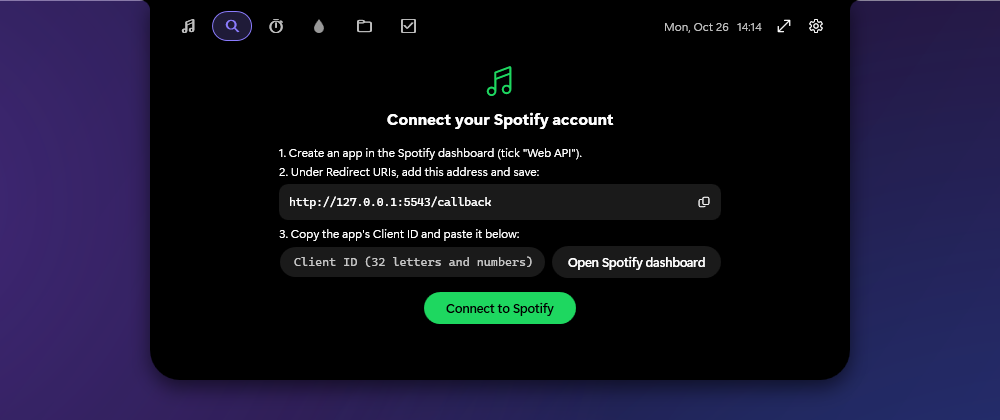
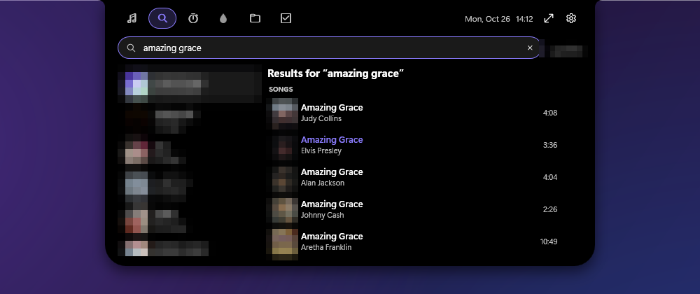

# Conectar o Spotify ao Solance

[English](SPOTIFY.md) · **Português (Brasil)** · [← Voltar ao README](../README.pt-BR.md)

O Solance mostra a música de **qualquer** player sem nenhuma configuração. Ao conectar o Spotify, você ganha uma **aba Spotify** onde pode:

- pesquisar músicas, artistas, álbuns e playlists
- ver **as suas** playlists e músicas curtidas
- tocar, adicionar à fila, ordem aleatória (inclusive a inteligente) e mudar o volume

Leva uns **dois minutos** e você faz **uma vez só**.

> ### Por que preciso do meu próprio Client ID?
> O Spotify exige que todo app que usa o serviço dele seja registrado. Em vez de todo mundo dividir um único registro (que tem limites rígidos e prenderia todos a uma só conta), **você cria um mini app seu, gratuito**, no painel de desenvolvedores do Spotify e entrega o *Client ID* dele ao Solance.
> - Nada passa pela conta ou pelo servidor de outra pessoa.
> - O Client ID **não é senha**. Não existe segredo para compartilhar.
> - Você entra na página do próprio Spotify. O Solance nunca vê a sua senha.

## Antes de começar

- Uma conta do Spotify.
- **Controlar a reprodução** (tocar, pausar, volume, aleatório, fila) por apps de terceiros é um recurso do **Spotify Premium**. Pesquisar e ver suas playlists não depende disso.
- As regras de desenvolvedor do Spotify mudam de tempos em tempos. Se o painel pedir algo que não está descrito aqui (por exemplo, conta Premium ou confirmações extras), siga as instruções dele.

---

## Passo a passo

### 1. Abra o painel de desenvolvedores do Spotify

Acesse **<https://developer.spotify.com/dashboard>** e entre com a sua conta do Spotify. Aceite os Termos de Desenvolvedor se ele pedir.

> No Solance você chega lá pelo botão **Abrir painel do Spotify**.

### 2. Crie um app

Clique em **Create app** e preencha:

| Campo | O que colocar |
|---|---|
| **App name** | `Solance` (qualquer nome serve) |
| **App description** | `Notch para Windows` (qualquer texto) |
| **Website** | deixe vazio |
| **Redirect URIs** | `http://127.0.0.1:5543/callback` → depois clique em **Add** |
| **Which API/SDKs are you planning to use?** | marque **Web API** |

Marque a caixa de concordância com os Termos de Desenvolvedor e clique em **Save**.

> **A Redirect URI precisa ser exatamente** `http://127.0.0.1:5543/callback`
> - use `127.0.0.1`, **não** `localhost`
> - `http`, não `https`
> - sem barra no final, sem espaços
> - é preciso clicar em **Add** (ela aparece como uma linha embaixo do campo) *e depois* em **Save**
>
> O Solance tem um **botão de copiar** ao lado desse endereço para você não precisar digitar.

### 3. Copie o Client ID

Abra o app que você criou e vá em **Settings** (botão no canto superior direito da página do app). Copie o **Client ID**: um código de **32 letras e números**.

> Não copie o **Client secret**. O Solance não precisa dele e avisa se você colar o código errado.

### 4. Cole no Solance

1. Passe o mouse no topo da tela para abrir o notch.
2. Abra a aba **Spotify** (ícone de lupa).
3. Cole o Client ID no campo e clique em **Conectar ao Spotify**.

<div align="center">

<br/><sub>As capturas de tela estão em inglês.</sub>
</div>

### 5. Autorize o acesso

O navegador abre a página do Spotify. Entre, se precisar, e clique em **Agree** (Concordo). Vai aparecer uma confirmação: pode fechar essa aba.

De volta ao Solance, a aba Spotify já mostra as suas playlists. Digite algo na busca e clique numa música para tocar.

<div align="center">

<br/><sub>Suas playlists, capas e nome estão borrados nesta imagem.</sub>
</div>

Você também pode fazer isso (ou mudar depois) em **Configurações → Spotify**.

---

## Solução de problemas

<details><summary><b>O navegador mostra “INVALID_CLIENT: Invalid redirect URI”</b></summary>

A Redirect URI do seu app no Spotify não confere. Abra o app → **Settings** → **Redirect URIs** e confirme que existe exatamente:

```
http://127.0.0.1:5543/callback
```

Remova outras versões (por exemplo com `localhost`, `https` ou com `/` no final), clique em **Add** e depois em **Save**. Tente conectar de novo.
</details>

<details><summary><b>“O Client ID tem 32 letras e números…”</b></summary>

O que você colou não é um Client ID. Copie o **Client ID** (32 caracteres) da página Settings do app, e não o Client secret, o nome ou o endereço do app.
</details>

<details><summary><b>“A porta 5543 está ocupada”</b></summary>

O Solance escuta em `127.0.0.1:5543` por alguns segundos enquanto você entra. Outro programa está usando essa porta. Feche o outro programa (ou reinicie o PC) e tente de novo.
</details>

<details><summary><b>Cliquei em “Agree” e nada acontece no Solance</b></summary>

Mantenha o Solance **aberto** durante o login (ele espera até 4 minutos). Se a página disser que não consegue conectar, confira se o Solance está aberto e se algum firewall ou ferramenta de segurança não está bloqueando conexões locais para `127.0.0.1`.
</details>

<details><summary><b>“O Spotify não liberou esse acesso para o app” / erro 403</b></summary>

Apps do Spotify em modo de desenvolvimento só aceitam contas permitidas no app. Se você usa uma **conta do Spotify diferente** da que criou o app, abra o app no painel → **Settings → User management** e adicione o nome e o e-mail dessa conta. Depois use **Desconectar** e **Conectar** de novo no Solance.
</details>

<details><summary><b>A busca funciona, mas a música não toca</b></summary>

- Controlar a reprodução exige **Spotify Premium**.
- Abra o **app do Spotify para computador** pelo menos uma vez. O Solance toca neste PC e tenta abrir o Spotify para você.
- Se aparecer “O Spotify não começou a tocar”, abra o app do Spotify, toque qualquer coisa e tente de novo pelo Solance.
</details>

<details><summary><b>“Sessão expirada. Conecte de novo.”</b></summary>

Vá em **Configurações → Spotify → Desconectar** e conecte de novo (não precisa criar outro app: o Client ID continua salvo).
</details>

<details><summary><b>O botão de aleatório não liga o modo inteligente</b></summary>

O Spotify não oferece o modo inteligente a outros apps. O Solance aperta o botão no **app do Spotify para computador** por você, então esse app precisa estar aberto neste PC.
</details>

## Desconectar, recomeçar ou remover o acesso

- **Desconectar do Solance:** *Configurações → Spotify → Desconectar*. Isso apaga o login salvo no seu PC.
- **Revogar o acesso no Spotify:** acesse <https://www.spotify.com/account/apps/> e clique em **Remove access** ao lado do seu app.
- **Apagar o app:** no painel de desenvolvedores, abra o app → **Settings** → **Delete app**.
- **Zerar o Solance por completo:** feche-o e apague a pasta `%AppData%\Solance`.

## O que o Solance pode e não pode fazer com a sua conta

- Ele **lê** suas playlists e músicas curtidas, **pesquisa** no catálogo e **controla a reprodução** nos seus dispositivos (tocar, fila, volume, aleatório).
- Ele **não** altera, cria nem apaga suas playlists, e **não** publica nada.
- O seu token de login é guardado **criptografado pelo Windows** e só o seu usuário do Windows consegue lê-lo.

---

*Spotify é marca da Spotify AB. O Solance é um projeto independente e não é afiliado, patrocinado nem endossado pelo Spotify.*
